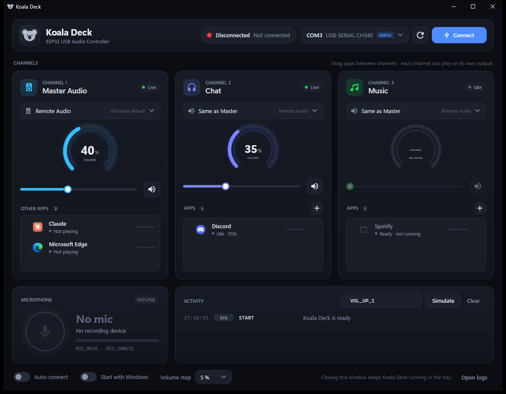
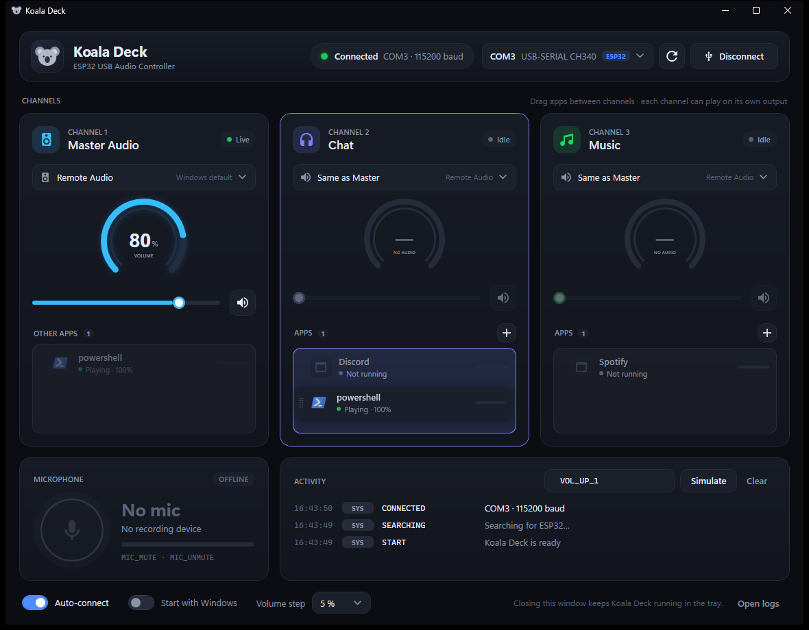
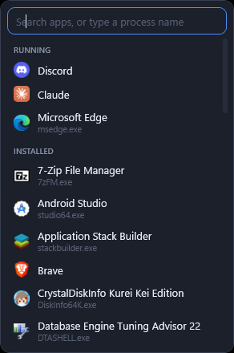

# Koala Deck

Windows companion app for **Koala Deck** — an ESP32-based USB hardware audio controller.
The application runs in the System Tray, listens to text commands from the ESP32 via USB Serial (115200 baud),
and controls Master volume, per-application volume (Volume Mixer), and microphone mute in real-time.



Drag & drop apps between channels:



**+** Popup (running apps + installed apps, with search):



- **Stack:** C# / .NET 10 (LTS) / WPF (UI) + WinForms `NotifyIcon` (tray) + NAudio (Windows Core Audio)
- **OS:** Windows 10 / 11
- **Requirements:** .NET 10 SDK. IDE: Visual Studio 2026 (*.NET desktop development* workload), VS Code with C# Dev Kit,
  Rider, or simply the `dotnet` CLI. Visual Studio 2022 cannot open .NET 10 projects.

## Build & Run

1. Open `KoalaDeck.sln` in Visual Studio 2026 → set `KoalaDeck` as the startup project → press **F5**.
2. Or via terminal:

```bash
dotnet run --project src/KoalaDeck
```

Publish a single `.exe` file (the .NET 10 runtime is bundled, so the target PC doesn't need to install .NET):

```bash
dotnet publish src/KoalaDeck -c Release -r win-x64 --self-contained true -p:PublishSingleFile=true -o publish
```

Unit tests (protocol parser, process name normalization, ESP32 port detection):

```bash
dotnet test
```

## Serial Protocol (ESP32 → PC)

One command per line, ending with `\n` (or `\r\n`), case-insensitive.

| Command | Action |
|---|---|
| `VOL_UP_1` / `VOL_DOWN_1` | Windows Master Volume ±step (default 5%) |
| `MUTE_TOGGLE_1` | Toggle Master mute |
| `VOL_UP_2` / `VOL_DOWN_2` | Chat app volume (default `Discord`) ±step |
| `MUTE_TOGGLE_2` | Toggle Chat app mute |
| `VOL_UP_3` / `VOL_DOWN_3` | Music app volume (default `Spotify`) ±step |
| `MUTE_TOGGLE_3` | Toggle Music app mute |
| `MIC_MUTE` / `MIC_UNMUTE` | Mute / unmute default recording device |
| `MIC_TOGGLE` | *(additional)* toggle microphone mute — handy for a single button |

Example on the ESP32 side (Arduino):

```cpp
void setup() { Serial.begin(115200); }
// encoder turned clockwise:
Serial.println("VOL_UP_2");
```

Other lines (e.g., ESP32 boot logs) are ignored and only appear in the **Activity** panel.
`VOL_UP_*` also unmutes the channel, similar to the Windows volume buttons.

## Features

- **Auto-detect COM port** — ports are scanned via WMI; ports with ESP32 USB VIDs
  (`303A` Espressif native USB, `10C4` CP210x, `1A86` CH340/CH9102, `0403` FTDI) are labeled *ESP32* and selected automatically.
  Bluetooth ports are never auto-selected.
- **Auto connect & reconnect** — a watchdog (1.5 seconds) detects when the cable is unplugged (read error *or* port missing from the list),
  safely closes the port, and reconnects when plugged back in — without crashing.
  If the COM number changes, Auto-connect finds the ESP32 on the new port.
- **App groups** — each channel card has a list of apps with their `.exe` icons, status
  (*Playing* / *Idle* / *Not running*), and live audio levels:
  - **Master** displays all running apps that haven't been added to a group: apps with open windows or audio sessions.
    Apps playing audio are at the top, the rest are alphabetical; a green dot = playing. The list is rescanned every 2 seconds.
  - **Chat / Music** contains its group members. Members remain visible even when the app is closed, preventing settings loss.
  - **Drag & drop** app rows between cards to move them. Drag to Master (or click ×) to remove an app from a group.
  - The **+** button opens a popup with a search box, containing two sections:
    - **Running** — currently running apps, with a *Playing* badge for those making sound.
    - **Installed** — apps from Start menu shortcuts that aren't open yet. Only appears in this popup, not in the Master list.
      Uninstallers, setups, and built-in Windows tools are skipped. Squirrel apps (Discord, Slack) are recognized by their real process names.
      Store (UWP) apps are not yet listed.

    Pressing Enter selects the best match or adds the typed text as a process name.
  - The displayed name is a friendly name ("Microsoft Edge" instead of `msedge`): Start menu shortcut title or `.exe` file description. The group still stores the process name.
  - Apps that haven't played audio yet can still be selected without errors. Their status is **Ready · not playing**, and group volume/output settings apply as soon as the app starts playing. Encoders on silent groups simply log "ready — not playing yet".
  - `VOL_*_2` / `VOL_*_3` encoders adjust **all** apps in the group simultaneously, across all output devices.
- **Output device per channel** — Speaker / Headset dropdown (icons based on device *form factor*):
  - **Master** changes the Windows *default output*.
  - **Chat / Music** routes apps in the group to the selected device, similar to Settings › Sound › Volume mixer › Output device.
    Windows remembers this preference per application. Apps that start playing later are automatically routed.
    *Same as Master* = follows Windows default.
- **Mic mute** — mutes the default recording device and default *communications* device if they differ
  (Discord/Teams usually records from the latter).
- **System Tray** — the X button hides the window to the tray. Tray menu: *Open Dashboard*, *Auto-start on Windows Boot*,
  *Reconnect Serial*, *Exit*. Tray icon colors: green (connected), yellow (searching), red (disconnected).
- **Start with Windows** — `HKCU\Software\Microsoft\Windows\CurrentVersion\Run` with the `--minimized` argument (straight to tray).
- **Single instance** — opening the app a second time brings the already running dashboard to the front.
- **Simulator** — type commands in the Activity panel (e.g., `VOL_UP_2`) to test without hardware.

## Project Structure

```text
KoalaDeck.sln
├─ src/KoalaDeck/
│  ├─ KoalaDeck.csproj            .NET 10 WPF (+ WinForms for tray), NAudio.Wasapi, System.IO.Ports, System.Management
│  ├─ app.manifest                Per-monitor DPI, asInvoker
│  ├─ App.xaml(.cs)               Composition root: services, tray, window, single instance, global exception handler
│  ├─ MainWindow.xaml(.cs)        Dark mode dashboard (connection bar, 3 channel cards, mic card, activity, footer)
│  ├─ Assets/KoalaDeck.ico        App icon (generated by tools/make-icon.ps1)
│  ├─ Controls/
│  │  ├─ ArcGauge.cs              270° ring gauge: volume (outer) + live audio level (inner)
│  │  ├─ AddAppButton.xaml(.cs)   + button: currently playing apps / type process name
│  │  └─ DragGhostAdorner.cs      "Ghost" app row following the cursor during drag
│  ├─ Interop/
│  │  ├─ AudioPolicyConfig.cs     Per-app output routing (WinRT AudioPolicyConfig, called via vtable)
│  │  ├─ PolicyConfig.cs          Change Windows default output (IPolicyConfig)
│  │  ├─ ShellLink.cs             Read target, arguments, and icons from .lnk shortcuts (IShellLinkW)
│  │  └─ NativeMethods.cs         Dark title bar (DWM), rounded tray menu corners, process exe path
│  ├─ Models/                     AppSettings (+ ChannelSettings, AppNames), DeckCommand, SerialPortInfo, AudioSnapshot, DeckActivity
│  ├─ Services/
│  │  ├─ AudioService.cs          NAudio Core Audio in a single MTA thread: volume, app groups, output routing, live snapshot
│  │  ├─ AppIconProvider.cs       Extract .exe icons (background, cached)
│  │  ├─ RunningAppScanner.cs     List of running apps (visible windows, excluding shell/background processes)
│  │  ├─ InstalledAppScanner.cs   Installed apps from Start menu shortcuts (for the + popup)
│  │  ├─ AppTitleProvider.cs      Friendly name from .exe file description
│  │  ├─ SerialService.cs         Port scanner, connect/disconnect, reader thread, reconnect watchdog
│  │  ├─ CommandParser.cs         Text protocol parser
│  │  ├─ DeckController.cs        Serial → Audio, command routing, Activity events
│  │  ├─ TrayIconService.cs       NotifyIcon + dark context menu
│  │  ├─ KoalaArt.cs              Render tray icon + status dots (GDI+)
│  │  ├─ SettingsService.cs       %AppData%\KoalaDeck\settings.json
│  │  ├─ StartupManager.cs        Registry Run key
│  │  ├─ SingleInstance.cs        Mutex + activation event
│  │  └─ Logger.cs                %LocalAppData%\KoalaDeck\koaladeck.log
│  ├─ Themes/                     Colors.xaml, Controls.xaml (dark style), Icons.xaml (vector icons + logo)
│  └─ ViewModels/                 MainViewModel, ChannelViewModel, AppRowViewModel, OutputDeviceItem, AudioAppItem,
│                                 MicViewModel, ActivityItem, RelayCommand
├─ tests/KoalaDeck.Tests/         xUnit
└─ tools/make-icon.ps1            Rebuild KoalaDeck.ico
```

## Threading & Error Handling

- **Audio:** all Core Audio COM calls run on a single MTA thread (`AudioService`). The UI and serial merely
  dispatch work to the queue and `await` the result, avoiding cross-apartment COM object usage.
  If a device is unplugged / the default device changes / an app closes its session, the service refreshes the devices and retries once.
- **Serial:** reading occurs on a background thread with a timeout; `IOException`/`UnauthorizedAccessException` are caught and
  passed to the watchdog. The port stream is explicitly closed (with `GC.SuppressFinalize`) to prevent known .NET finalizer crashes
  when a USB adapter is removed.
- **UI:** events from other threads are marshaled via `Dispatcher.InvokeAsync`. Live meters are only polled (20 fps) when the dashboard
  is visible; while in the tray, the app is practically idle.
- `DispatcherUnhandledException`, `AppDomain.UnhandledException`, and `TaskScheduler.UnobservedTaskException` are logged.

## Settings

`%AppData%\KoalaDeck\settings.json` (auto-generated):

| Key | Default | Description |
|---|---|---|
| `LastPort` | `null` | Last successfully connected port |
| `AutoConnect` | `true` | Connect on startup + search for ESP32 if the port changes |
| `BaudRate` | `115200` | |
| `Channel2.Apps` / `Channel3.Apps` | `["Discord"]` / `["Spotify"]` | Group members (process names without `.exe`); an app can only be in one group |
| `Channel2.OutputDeviceId` / `Channel3.OutputDeviceId` | `null` | Target routing endpoint ID; `null` = *Same as Master* |
| `AppPaths` | `{}` | Previously seen `.exe` paths, keeping icons visible when apps are closed |
| `VolumeStepPercent` | `5` | Change per command |
| `DtrEnable` | `null` | `null` = automatic: ON for Espressif native USB (ESP32-S2/S3 TinyUSB requires DTR), OFF for CP210x/CH340 (DTR triggers auto-reset circuits) |

Legacy settings (`Channel2Target` / `Channel3Target`) are automatically migrated to the group format.

## Troubleshooting

- **"COMx is in use by another program"** — close the Arduino IDE / PlatformIO Serial Monitor; Koala Deck will connect automatically.
- **Chat/Music channel shows "NO AUDIO"** — the app in the group hasn't opened an audio session yet (e.g., Spotify hasn't played).
  The app name must be the process name without `.exe` (see Task Manager → Details).
- **"Windows refused to send … to Remote Audio"** — via Remote Desktop, the only output is *Remote Audio*,
  and Windows doesn't allow it as a per-app output. Per-app routing works on PCs with local Speakers / Headsets.
- **Chat/Music output choices are disabled** — per-app routing requires Windows 10 1803 or newer.
- **ESP32-S3 not sending data** — set `"DtrEnable": true` in `settings.json`.
- Logs are located at `%LocalAppData%\KoalaDeck\koaladeck.log` (*Open logs* button in the footer).